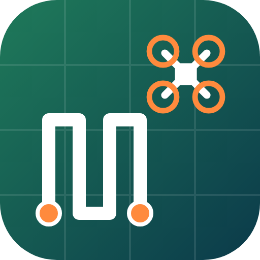

# FlyPlan: Mapping & Waypoints

Plan mapping surveys, orbits and waypoint missions for DJI drones that fly waypoints in **DJI Fly**, and send them
straight to the controller over USB, from an **Android tablet** or a **Windows PC**.

> **Not affiliated with DJI.** FlyPlan writes waypoint mission files that DJI Fly loads. It comes with no warranty.
> Always check the route in DJI Fly before you fly, keep the drone in sight, and follow the rules where you fly.

**Tested with:** DJI Air 3S + DJI RC 2 (DJI Fly). Other drones and controllers that fly DJI Fly waypoint missions
(RC Pro 2, RC-N2/N3 with a phone, Mini 4 Pro, Air 3) may work but haven't been tested.

## Download
Get the latest version from **[Releases](../../releases)**:
- **FlyPlan.apk** for Android tablets and phones (Android 7 or newer). You may need to allow installing apps from your browser or file manager.
- **FlyPlan for Windows.zip**: unzip, keep `WebView2Loader.dll` next to `FlyPlan.exe`, and run `FlyPlan.exe`.
  Windows SmartScreen will warn the first time because the app isn't code-signed: choose *More info*, then *Run anyway*.

## Features
- **Mapping surveys** from a rectangle or polygon: line spacing from camera, altitude and overlap; most-efficient line
  direction; ground resolution; *Plan by goal* (pick the detail and batteries, get the settings).
- **POI orbits**, including several orbits at different heights and radii, with the camera aimed at the subject.
- **Waypoints** with altitude, speed, heading, gimbal, photo, video and hover actions.
- **Combined missions**: orbit, then survey, then waypoints, all in one mission.
- **Battery-sized parts** (30 minutes by default): parts break between survey lines, never mid-orbit, and stay under DJI's waypoint limit.
- **Terrain following** from USGS elevation data.
- **Send to controller over USB**: replaces a placeholder mission you saved in DJI Fly, after backing it up.
- **Your own maps**: import an orthomosaic as MBTiles (from WebODM, QGIS and others) as a basemap.
- **Offline maps** (Android): USGS aerial imagery and terrain for areas with no signal.
- **Features**: markers (stands, feeders, cameras, gates…), boundaries and lines, photos on features, geotagged photos
  to markers, and KML/KMZ/GPX import and export (works with exports from Google Earth, onX, Avenza and others).
- **Measure** distances, areas and elevation profiles.
- **Sync** between tablet and PC through one file in your own Google Drive. There's no FlyPlan server or account.

## How sending works
1. In DJI Fly, open **Waypoints**, drop two points and **save**. This is your placeholder. Close DJI Fly.
2. Connect the controller by USB-C (set it to *File transfer* if asked).
3. In FlyPlan: **Send to controller → Find controller**, pick the placeholder, then **Replace**.
4. Open the mission in DJI Fly, check the route, and save it.

DJI app or firmware updates may change how missions are stored. Test with a short, safe mission after updating.

## Building from source
| Part | Path | Build |
|---|---|---|
| The planner itself (shared) | `assets/` | HTML/JS/CSS + [Leaflet](https://leafletjs.com) |
| Android | `src/`, `res/`, `AndroidManifest.xml` | `./build.sh` (Android SDK platform 23, build-tools 29, Java 8). Needs your own signing keystore. |
| Windows | `win/` | Rust (tao, wry/WebView2, Windows Portable Devices, rusqlite). `cargo build --release` on Windows, or `win/build_win.sh` to cross-compile. |
| Browser PC build | `pc/` | `./build_pc.sh` (Edge/Chrome; can't send to the controller) |

## Map data
- Esri World Imagery and World Street Map (online only), © Esri and its data providers.
- USGS The National Map imagery (public domain, US only).
- Elevation: Terrain Tiles on AWS (USGS 3DEP and others).

## License
**[PolyForm Noncommercial 1.0.0](LICENSE.md)**: free to use, change and share for any noncommercial purpose.
**Selling it, or using it for commercial purposes, isn't allowed** without the author's permission.

Copyright © 2026 William Ketchel
